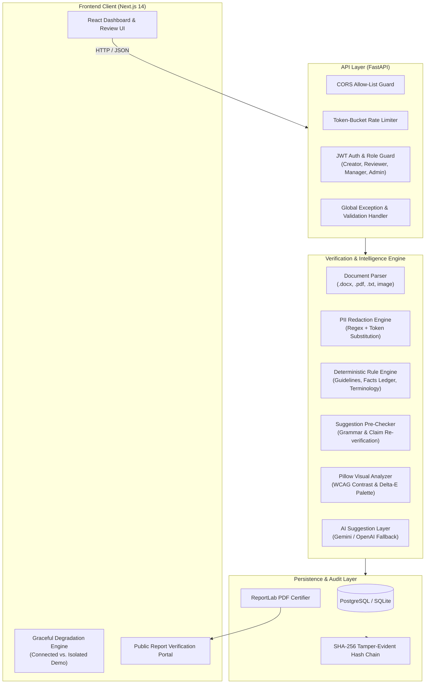

# BrandProof System Architecture

BrandProof is an enterprise-grade brand governance and compliance verification platform. It enforces brand guidelines, verified factual claims, and visual standards across multi-author marketing teams through deterministic verification, cryptographic audit trails, and privacy-preserving AI assistance.

---

## 1. System Pipeline & Data Flow

### Ingestion & Validation
1. **Document Sniffing**: Files uploaded via `/api/reviews/upload` are validated using magic numbers (content sniffing) to ensure only valid `.docx`, `.pdf`, `.txt`, and images (JPEG/PNG) up to 5 MB are ingested.
2. **Text Normalization**: Content is stripped of unprintable control characters, trimmed, and capped at 50,000 characters to prevent denial-of-service payloads.

### Privacy-Preserving AI Pipeline (Improvement 3)
1. **Redaction Pre-pass**: When `confidential_mode` is enabled (or workspace default is active), the text passes through the redaction engine.
2. **Token Substitution**: Emails, phone numbers, currencies, 8+ digit sequences, `[[ brackets ]]`, and confidential terms are replaced with `[REDACTED_TYPE_N]` tokens.
3. **External Provider Call**: The redacted copy is transmitted to Gemini/OpenAI for semantic suggestion synthesis. Raw confidential text never leaves the backend boundary.
4. **De-tokenization**: Upon response, original text tokens are restored before database storage.
5. **AI Disclosure Logging**: Every external call is logged in the `ai_calls` table with latency, model, and token metrics.

### Deterministic Rule Engine
1. **Terminology Checking**: Identifies prohibited or discouraged phrases and suggests preferred alternatives.
2. **Factual Claims Ledger**: Matches product claims against verified factual entries (e.g., "#1 healthy breakfast", "cut sugar cravings"). Checks effective and expiration dates to flag outdated claims.
3. **Clause Citation**: Every flagged finding cites an exact clause ID from the active Brand Guidelines.

### Suggestion Pre-Checking (Phase 4)
1. Before presenting a suggested correction to the user, the engine applies the replacement to a sandboxed copy of the text.
2. The modified copy is re-evaluated by the rule engine. If the edit introduces a new violation or injects an unverified claim, the suggestion is suppressed and flagged as "Needs a human look".

### Visual Asset Analyzer (Phase 7 / Improvement 2)
1. Uploaded imagery is processed deterministically using Python's Pillow library.
2. Dominant colors are quantized to compute relative luminance and evaluate WCAG 2.1 AA text contrast ratios ($\ge 4.5:1$).
3. Color proximity to approved brand palette hex codes is calculated using CIE76 Euclidean distance ($\Delta E \le 12.0$).
4. Evaluates missing alternative text attributes for screen readers.

---

## 2. Cryptographic Audit Log & Immutability

Every modification, finding decision, custom edit, and management approval appends a row to the `audit_logs` table.

### SHA-256 Hash Chain
To ensure non-repudiation and prevent retroactive tampering:
$$\text{entry\_hash} = \text{SHA-256}\Big(\text{canonical\_json}(\text{timestamp}, \text{action}, \text{user\_id}, \text{review\_id}, \text{payload}) + \text{prev\_hash}\Big)$$

- The genesis record initializes with an empty previous hash (`""`).
- Any manual update or deletion in the database breaks the mathematical chain, which is instantly reported by `GET /api/audit/verify`.

### Publicly Verifiable PDF Certificates
- The system generates signed PDF compliance certificates via ReportLab.
- Each PDF is stamped with a cryptographic SHA-256 fingerprint derived from the review state and audit history.
- External parties can upload or query the document fingerprint at `/verify-report` to verify authenticity against the live ledger.

---

## 3. Guideline Health & Governance Engine (Improvement 1)

1. **Telemetry Ingestion**: Every user finding decision (`accept`, `edit`, `reject`) records the associated clause and rationale.
2. **Override Calculation**:
   $$\text{Override Rate} = \frac{\text{Rejections} + \text{Custom Edits}}{\text{Total Findings on Clause}}$$
3. **Threshold Alerts**: Clauses exceeding a 40% override rate are flagged as outdated or ambiguous.
4. **Conflict Detection**: Heuristic keyword matrix detects contradictory directives between clauses (e.g., "always use full legal name" vs. "keep social headlines under 5 words").
5. **Backtesting Simulator**: Allows compliance administrators to test revised rule definitions against historical reviews to verify false-positive reductions before pushing policies live.

---

## 4. Hardest Engineering Problems Solved

1. **Phrase-Level Grammar Preserving Rewriter**: Flagged spans often slice sentences mid-clause (e.g. replacing `"India's #1 healthy breakfast!"` with `"India's leading breakfast option!"`). In earlier iterations, sequential replacements caused duplicated tokens (e.g., `"Nila Nila"`). We developed clause boundary expansion and token normalization so accepting all findings in any permutation yields 100% compliant, fluent text.
2. **Zero-Dependency Headless Image Contrast**: Determining contrast on arbitrary raster images without massive machine-learning weights required building a luminance extraction algorithm based on Pillow histogram quantization and WCAG 2.1 formulas ($L_1 + 0.05 / L_2 + 0.05$).
3. **Zero-Trust AI Privacy Redaction**: Preventing PII leakage while preserving grammatical context for external LLMs required a bidirectional token map with strict isolation from the LLM prompt context.
